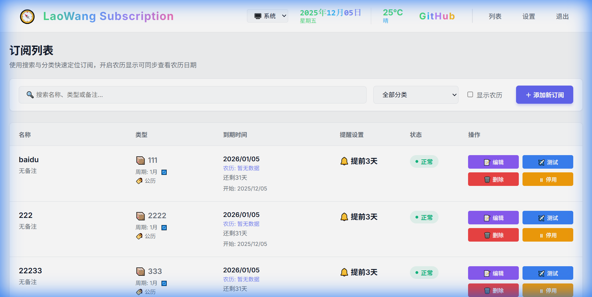
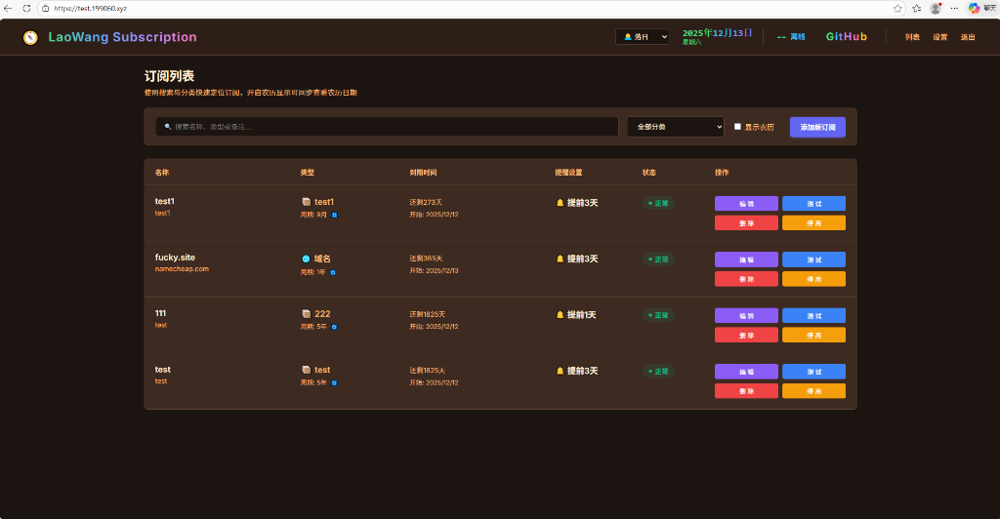
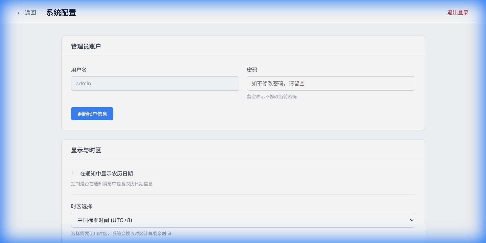
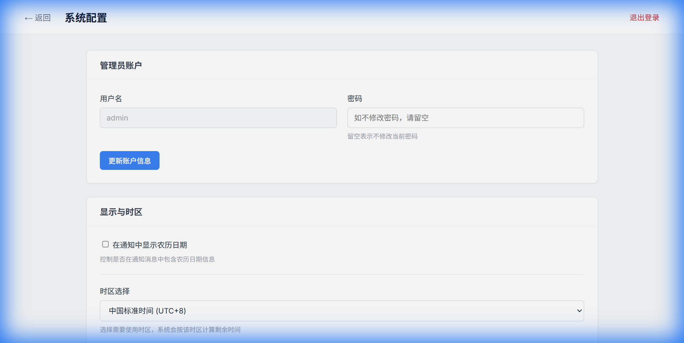

# 🐻 老王订阅管理系统 (LaoWang Subscription)

> **专为个人打造的订阅费用与到期管理神器**
>
> 告别 Excel，用最优雅的方式管理你的 Netflix、Spotify、域名、服务器VPS等周期性支出。只有真正的后端服务，才能提供真正的到期推送提醒！

[](https://github.com/tony-wang1990/laowang-subscription)
[](https://hub.docker.com/)
[](LICENSE)

## ✨ 核心亮点

### 🎨 极致的视觉体验

- **双视图切换**：[≡ 列表模式] 高效扫视 / [⊞ 卡片模式] 沉浸浏览。
- **📅 日历视图 (v1.5)**：月历形式直观展示每一天的付款计划。
- **PWA 支持**：可添加至手机桌面，像原生 App 一样流畅使用。

### 🤖 强大的自动化能力

- **📢 全渠道推送**：支持 Telegram、微信(企业微信)、Bark(iOS)、Email 邮件通知。
- **⏰ 精准提醒**：支持「提前N天」、「当天」、「过期后」多阶段提醒，绝不错过续费日。
- **💰 智能统计**：自动汇率转换，实时计算「本月待付」和「年度总支出」。
- **🛡️ 状态监测**：实时检测后台健康状态，断网即报警，防丢失。
- **💾 数据备份**：支持一键下载 SQLite 数据库文件，确保数据安全。

### 🛠️ 深度本地化

- **农历支持**：符合国人习惯的日期显示。
- **自动天气**：根据 IP 自动显示当地天气。

---

## 📸 界面预览

| ☀️ 浅色主题 (Light) | 🌙 深色主题 (Dark) |
| :---: | :---: |
|  |  |

### ⚙️ 设置页 / 通知配置

| ☀️ 浅色主题 (Light) | 🌙 深色主题 (Dark) |
| :---: | :---: |
|  |  |

---

## 🏗️ 部署指南 (Deployment)

本项目基于 **Node.js + SQLite** 开发，依赖持久化存储（Database）和常驻进程（Cron Job），因此**最推荐使用 Docker 部署**。

### ✅ 支持平台

- **VPS / 云服务器**：完全支持 (Ubuntu, Debian, CentOS 等)
- **架构支持**：**AMD64 (x86)** 和 **ARM64** (如 Oracle 甲骨文 ARM、树莓派) 均完美运行。

### ❌ 不支持平台

- **Cloudflare Workers / Pages**：不支持 (无持久化文件系统)
- **Vercel / Netlify**：不支持 (Serverless 无法运行持久化 Cron 任务)

---

### 🚀 方式一：Docker 一键部署 (推荐)

直接复制以下命令到服务器终端即可：

```bash
docker run -d \
  --name laowang-subscription \
  -p 3001:3001 \
  --restart always \
  -v $(pwd)/database:/app/database \
  -e TZ=Asia/Shanghai \
  -e PORT=3001 \
  -e JWT_SECRET=请替换为长随机字符串 \
  ghcr.io/tony-wang1990/laowang-subscription:main
```

> **注意**：v1.5.0 版本默认端口为 **3001**。

### 📂 方式二：Docker Compose (高级)

创建 `docker-compose.yml`：

```yaml
version: '3'
services:
  app:
    image: ghcr.io/tony-wang1990/laowang-subscription:main
    container_name: laowang-subscription
    restart: always
    ports:
      - "3001:3001"
    volumes:
      - ./database:/app/database # 数据持久化挂载
    environment:
      - TZ=Asia/Shanghai         # 时区设置（影响提醒时间）
      - PORT=3001                # 端口配置
      - JWT_SECRET=请替换为长随机字符串  # 生产环境必填，否则重启后登录失效
      # - DEMO_DATA=1            # 可选：首次启动灌入演示数据，默认关闭
```

然后运行：

```bash
docker-compose up -d
```

### 💻 方式三：本地开发/手动部署

需 Node.js >= 20（与 `package.json` 的 `engines` 一致）：

```bash
# 1. 安装依赖
npm install

# 2. 启动服务 (同时启动前端和后端)
npm run dev

# 访问 http://localhost:5173 (开发模式) 或 http://localhost:3001 (生产模式)
```

---

## ⚙️ 环境变量配置

| 变量名 | 必填 | 默认值 | 说明 |
| :--- | :--- | :--- | :--- |
| `PORT` | 否 | 3001 | 服务监听端口（Zeabur 等平台可用 `WEB_PORT` 覆盖） |
| `WEB_PORT` | 否 | — | 平台注入端口，优先于 `PORT` |
| `TZ` | 否 | UTC | 系统时区，**强烈建议设置为 Asia/Shanghai** 以保证提醒时间准确 |
| `JWT_SECRET` | 否 | 随机 | 用于加密 Session，建议生产环境固定一个长字符串；未设置时每次启动随机生成，已签发的登录会失效 |
| `DATA_DIR` | 否 | `./database` | SQLite 数据库目录 |
| `DEMO_DATA` | 否 | `0` | 设为 `1` 时首次启动灌入演示订阅数据；默认关闭，空库不再自动灌入 |

## 🔐 安全说明

- **首次启动**：用户表为空时自动创建管理员账号 `admin`，口令为随机生成的强口令，**仅在启动日志中打印一次**。请立即登录并修改密码（设置页 → 管理员账户，需提供当前密码，新密码至少 8 位）。没有任何默认口令。
- **注册接口已关闭**：`POST /api/auth/register` 仅在用户数为 0 时可用；已有用户后一律返回 403。
- **设置接口脱敏**：`GET /api/settings` 对 Token / 密码 / 密钥类字段只返回是否已配置，不返回原始值；修改密钥需重新输入，留空表示不改动。`POST /api/settings` 仅接受已知字段。
- **请务必设置 `JWT_SECRET`**：生产环境请使用长随机字符串，不要照抄示例值。

## 🇬🇧 Quick Start (English)

LaoWang Subscription is a self-hosted subscription & renewal reminder manager (Node.js + SQLite + Vue).

```bash
# Docker (recommended)
docker run -d \
  --name laowang-subscription \
  -p 3001:3001 \
  --restart always \
  -v $(pwd)/database:/app/database \
  -e TZ=Asia/Shanghai \
  -e PORT=3001 \
  -e JWT_SECRET=<a-long-random-string> \
  ghcr.io/tony-wang1990/laowang-subscription:main

# Local development (Node.js >= 20)
npm install
npm run dev   # http://localhost:5173 (dev) or http://localhost:3001 (production)
```

On first start, a random admin password is printed **once** in the startup log — log in with it and change it immediately (Settings → Admin account). There is no default password. Registration (`POST /api/auth/register`) is disabled once any user exists. See [CHANGELOG.md](CHANGELOG.md) for v1.5.0 changes.

---

## 🔄 如何更新？

使用了 Docker 的用户，推荐使用 Watchtower 自动更新，或者手动执行：

```bash
docker pull ghcr.io/tony-wang1990/laowang-subscription:main
docker stop laowang-subscription
docker rm laowang-subscription
# ...重新运行上面的 docker run 命令
```

---

## 📝 常见问题 (FAQ)

**Q: 为什么 Cloudflare 不能用？**
A: 本项目使用 SQLite 数据库存储您的隐私数据，Cloudflare 等 Serverless 平台在重启后会清空文件，导致数据丢失；且无法维持定时任务（发通知）。请使用几十块钱一年的 VPS 部署，数据更安全。

**Q: 首次登录用的账号密码是什么？**
A: 首次启动时，服务会在日志里打印一次随机生成的管理员初始口令（账号 `admin`），请立即登录并修改密码。没有任何默认口令；如果错过日志，删除 `database/subscription.db` 后重新启动会重新生成（会清空全部数据）。

**Q: 点击保存没反应？**
A: 检查页面顶部是否有红色“离线”警告。如果有，请检查容器日志。v1.5.0 之后端口改为 3001，请确保您的防火墙放行了 3001 端口。

---

Copyright © 2024-2025 LaoWang. MIT License.

## 致谢

感谢开源社区的交流与反馈。本项目在 [LINUX DO](https://linux.do/) 社区分享，欢迎在社区里讨论订阅管理的使用心得。
